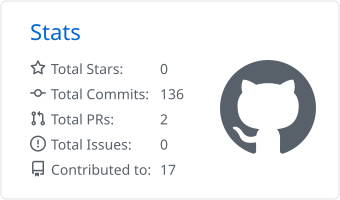
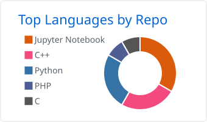

  

<h2 align="center">Hi there, I'm Kho Wei Cong 😄</h2>

  

I build web apps that solve real problems for real users, and look for ways to make them smarter with AI 🤖✨

  
  
  

---

## 🙋‍♂️ About Me

- 🎓 **Bachelor of Computer Science (Hons), Artificial Intelligence** — Multimedia University · CGPA 3.78/4.00
- 🎓 **Diploma in Information Technology** — Multimedia University · CGPA 3.48/4.00
- 📍 Based in Johor Bahru, Malaysia
- 🗣️ Languages: English, Chinese, Malay
- 🎯 Final Year Project: *Real-Time Drowsiness Detection Using Facial Cues via a Mobile Application*
- 🔭 Current focus: Internal Systems · Full-Stack Development · System Design
- 🌱 Interested in: AI Engineering · ML Engineering · DevOps

---

## 🌟 Featured Project

### 😴 Real-Time Drowsiness Detection Using Facial Cues via a Mobile Application

My Final Year Project for the Bachelor of Computer Science (Honours), Artificial Intelligence programme — a **mobile application that detects driver drowsiness in real-time** using facial cues captured via a smartphone camera, requiring no extra hardware.

**Key features:**
- 📡 **Real-time streaming** — front camera frames sent to a Python backend via WebSockets with minimal latency
- 🧠 **Hybrid detection** — rule-based tracking (Eye Aspect Ratio, Mouth Aspect Ratio, Blink Rate via MediaPipe Face Mesh) combined with a custom TensorFlow/Keras deep learning model
- 👁️ **Cue recognition** — detects microsleeps, prolonged eye closure, prolonged yawning, and abnormal blink rates
- 🔔 **Audio alarm** — triggers on-device to wake the driver when fatigue is detected
- 📊 **Live dashboard** — displays EAR, MAR, blink rate, confidence, and ping in real time

📎 [View Project Repository](https://github.com/sylvesterkho1113/real-time-drowsiness-detection-app)

---

## 📂 More Projects

<h3>🌐 Full-Stack Web</h3>

| Project | Description | Stack |
|---|---|---|
| 🎓 **APEX Home Tuition** *(private, client project)* | Bilingual (中文 / English) website and tuition management system for a Johor Bahru home tuition service: parent enquiries, tutor applications, a 36-question learning-preference questionnaire, and portals for students, parents, teachers and admin |       |
| 🕒 [**ClockClock**](https://github.com/chwankai/ClockClock-Employee-Attendance-System) · [Live Demo](https://clock-clock-eas.vercel.app) | Employee attendance system with QR check-in codes that refresh every 60 seconds, role-based dashboards (Super Admin / Admin / Employee) and automatic credential emails over SMTP |      |
| 💰 [**Personal Financial Tracker**](https://github.com/sylvesterkho1113/personal_financial_tracking_system) | Finance tracker that scans receipt photos with local OCR and categorizes spending, using a scikit-learn classifier trained on the user's own corrections |      |
| 👟 [**Nike E-Commerce**](https://github.com/sylvesterkho1113/nike-ecommerce-fyp-diploma) | Diploma Final Year Project: online shoe store with cart, checkout, order tracking and an admin backend |    |

<h3>🤖 AI / Machine Learning / Computer Vision</h3>

| Project | Description | Stack |
|---|---|---|
| ♻️ [**Waste Classification**](https://github.com/sylvesterkho1113/Computer_Vision_Waste_Classification) | Sorts waste images into plastic, paper and organic, comparing HOG + SVM against ResNet50 and VGG16 transfer learning |     |
| 🚗 [**Vehicle Edge Detection**](https://github.com/sylvesterkho1113/TPC-Project2) | Desktop app running Sobel, Prewitt, Roberts and Canny edge detectors, with GPU acceleration through ILGPU |     |
| ✈️ [**Flight Ticket Price Prediction**](https://github.com/sylvesterkho1113/PredictingFlightTicketWithMachineLearningModel) | Predicts air ticket base fares from 50k flight records, comparing Linear Regression, KNN and Random Forest |    |
| 📈 [**Student Performance Prediction**](https://github.com/sylvesterkho1113/Student_Performance_Prediction_System_Compare_With_Different_CI_Model) | Predicts final exam marks and compares ANN, DNN and fuzzy logic models |    |
| 🧭 [**Career Path Expert System**](https://github.com/sylvesterkho1113/Rule-Based_Career_Path_Recommendation_Expert_System) | Rule-based expert system that recommends IT careers from education, experience, skills and personality |    |
| 🧑‍🎓 [**Semantic Student Management**](https://github.com/sylvesterkho1113/StudentManagementSystem) | Student records with CGPA calculation, SPARQL-based subject recommendations and PDF result slips |     |

<h3>🎮 Graphics & Desktop / Console Systems</h3>

| Project | Description | Stack |
|---|---|---|
| 📦 [**Blindbox Character Design**](https://github.com/sylvesterkho1113/BlindboxCharacterDesign) | 3D OpenGL scene with figurine-style characters, hierarchical animation, multi-source lighting and an interactive battle system |   |
| 📚 [**Library Management System**](https://github.com/sylvesterkho1113/LibraryManagementSystem) | Desktop app for managing books, members, loans and returns |   |
| 📖 [**BookStore System**](https://github.com/sylvesterkho1113/BookStoreSystem) · [v2](https://github.com/sylvesterkho1113/BookStoreSystem2) | Console bookstore with admin and customer modes, cart, orders, sales reports, plus sorting and binary search |  |
| 🍽️ [**Restaurant Delivery System**](https://github.com/sylvesterkho1113/RestaurantDeliveryManagementSystem) | Console app for ordering, order tracking and restaurant admin tasks |  |
| 📝 [**Result Record System**](https://github.com/sylvesterkho1113/ResultRecordSystem) | Lecturer and student portals for recording marks, with automatic grading |  |

---

## 💻 Tech Stack

### Programming Languages

  
  
  
  
  
  
  
  

### Full-Stack Web Development

| Layer | Technologies |
|---|---|
| 🎨 Frontend |       |
| ⚙️ Backend |        |
| 📱 Mobile |  |
| 🖥️ Desktop |    |

### AI / Machine Learning / Data Science

| Category | Technologies |
|---|---|
| 📊 Data Handling |   |
| 📈 Visualization |   |
| 🧠 Modeling |      |
| 👁️ Computer Vision |   |

### Tools & Platforms

| Category | Technologies |
|---|---|
| ☁️ Cloud & Hosting |      |
| 🔧 Version Control |   |
| 🎨 Design |   |
| 🗄️ Database |    |
| 🕹️ Graphics |  |

---

## 📊 GitHub Stats

  <picture>
    <source media="(prefers-color-scheme: dark)" srcset="profile-summary-card-output/github_dark/3-stats.svg"/>
    
  </picture>
  <picture>
    <source media="(prefers-color-scheme: dark)" srcset="profile-summary-card-output/github_dark/1-repos-per-language.svg"/>
    
  </picture>

  

---

## 💼 What I'm Doing Now

- 🏢 Permanent in the **System Architecture** department at Wiwynn Technology Service Malaysia Sdn. Bhd., building internal systems tailored to internal users' requirements
- 🔧 Gaining hands-on experience in requirement gathering, full-stack architecture, and iterative delivery
- 🤖 Looking for ways to bring AI/ML into practical, everyday web applications
- 🧭 Planning to deepen my skills in AI/ML engineering and DevOps

---

## 💭 Quote

> "You only live once, but if you do it right, once is enough."

